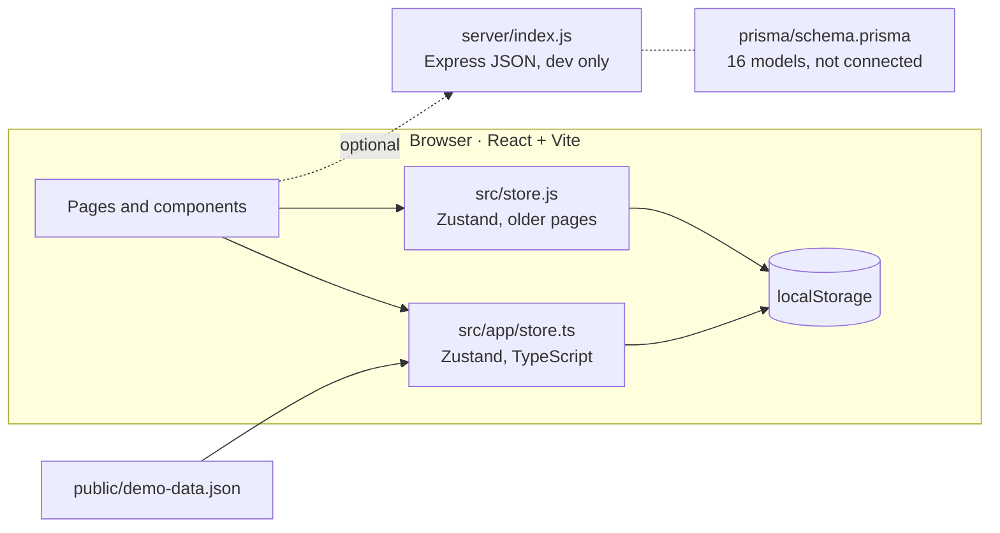

# 3. Architecture

[← Design](02-design.md) · Next: [Key decisions →](04-decisions.md)

## Static demo mode

The live demo runs entirely on GitHub Pages:
- **HashRouter**, because Pages can't rewrite deep links.
- Lazy-loaded routes.
- Data in localStorage, seeded from `public/demo-data.json` on the first visit.
- A production build puts the entry chunk at about 121 kB gzipped.

## Two stores

The app has two Zustand stores: an older JavaScript one (`src/store.js`) and a newer TypeScript one (`src/app/store.ts`). Pages built at different times read different stores. That caused the demo's most visible bug: the older store read the session once at load, before the newer store's demo-data fetch finished, so a first visit showed "Login to see your dashboard" until a reload.

**Fixed (Nov 2026):** the newer store now updates the older one when the demo session is created. The real fix is merging them into one store, which I'd do before building anything else on this code.

## The designed backend

`server/index.js` is an Express server with JSON-file persistence for local development; the front end falls back to local data without it. `prisma/schema.prisma` designs 16 models for a real database. It's architecture on paper, and isn't connected to anything.
